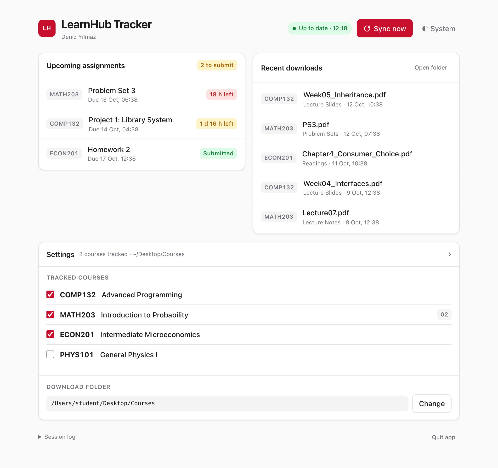

# LearnHub Tracker

Downloads the files of your Koç University LearnHub courses to your Mac and reminds you of upcoming assignment deadlines.

- **Files:** new slides, notes and readings of the courses you pick are downloaded into a `Courses` folder, one folder per course.
- **Assignments:** you get a notification for new assignments and for deadlines within 48 hours that you have not submitted yet.
- **Safe:** it only reads from LearnHub, it never changes or submits anything, and it never overwrites a file on your Mac. Your password is typed only into the KU login page.

## Requirements

- A Mac
- Google Chrome (used for the KU NetID login)

## Getting started

1. On this page click **Code → Download ZIP**, then double-click the downloaded ZIP to unpack it. Move the folder wherever you like (for example to Documents).
2. Double-click **`Start.command`** in that folder.
   - macOS may say it cannot verify the file because it was downloaded from the internet. Open **System Settings → Privacy & Security**, scroll down, click **Open Anyway** next to `Start.command`, then double-click it again. This is needed only once.
   - The first start installs what it needs (about a minute). If macOS offers to install developer tools, accept, then double-click `Start.command` again.
3. The app opens in your browser. Click **Log in with KU NetID** and log in in the Chrome window that opens; it closes by itself.
4. Check the courses you want to track and click **Save selection**. Choose where to save files; a `Courses` folder is created there. Downloading starts.

## Daily use

Double-click `Start.command`. Keep the Terminal window it opens running (you can minimize it): while it runs, LearnHub is checked every 3 hours. **Sync now** checks right away. To stop, click **Quit app** on the page or close the Terminal window.

- Files you delete are downloaded again on the next sync.
- To change the download folder later: **Settings → Change**.

## For developers

- `learnhub.py`: LearnHub client (only 5 allowed read functions, see `READ_ONLY`), file sync, assignment notifications, command line: `.venv/bin/python learnhub.py login | courses | sync`
- `app.py` + `ui.html`: local UI (`127.0.0.1` only, a new secret key on every start).
- `Start.command`: creates `.venv`, installs `requirements.txt` when it changes, runs `app.py`.
- Settings, download history and the login token: `~/Library/Application Support/Course_Tracking_System/` (the token file is readable only by your user).
- Tests: `.venv/bin/python test_learnhub.py && .venv/bin/python test_app.py`
